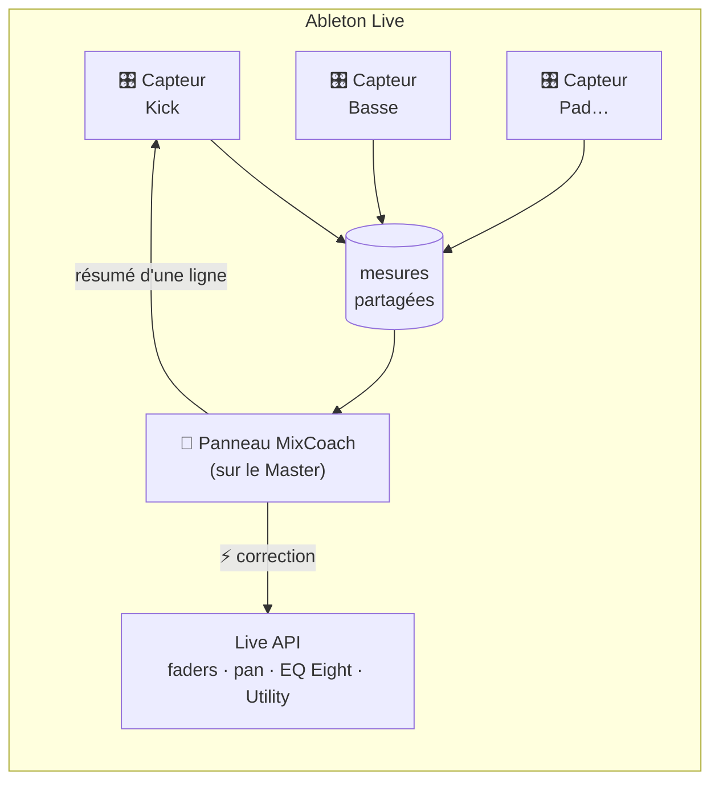

<p align="center">
  
</p>

<p align="center">
  <a href="https://github.com/xeewi/mixcoach/actions/workflows/tests.yml"></a>
  
  
  
  
  <a href="LICENSE"></a>
</p>

<p align="center">
  <a href="README.md">English</a> · <b>Français</b>
</p>

---

**MixCoach écoute chaque piste de ton projet Ableton Live et te dit, avec des mots simples, quoi corriger dans ton mix, comment le faire dans Ableton, et *pourquoi* c'est important.**
Il est fait pour les producteurs qui n'ont jamais appris le mixage ni la théorie musicale. Pas besoin de savoir ce que veulent dire « masquage » ou « headroom » : MixCoach t'explique tout comme un ami assis à côté de toi au studio. Et si tu es pressé, un bouton ⚡ applique la correction à ta place.

<p align="center">
  
</p>

## Pourquoi MixCoach ?

La plupart des premiers mix ont les mêmes défauts : un grave boueux, un kick et une basse qui se battent, un lead agressif, une basse qui s'effondre sur une sono de club. Un analyseur de spectre te *montre* ces problèmes sous forme de courbes, ce qui n'aide que si tu sais déjà les lire.

MixCoach va plus loin :

- 🎯 **Il compare tes pistes entre elles**, pas seulement le master. Il ne se contente pas de « trop de 300 Hz » : il te dit *« le Pad apporte 60 % de la boue entre 250 et 500 Hz, creuse-le là »*.
- 🗣️ **Il explique tout avec des mots de tous les jours**, avec des images (« comme deux personnes qui parlent en même temps »), et dit toujours ce que tu gagnes à corriger.
- 🛠️ **Il parle Ableton** : chaque conseil est une liste d'étapes avec les vrais noms des devices et réglages (EQ Eight → Bell → 120 Hz → −3 dB).
- ⚡ **Il peut corriger pour toi** : un clic recentre un panoramique, monte un fader, ou ajoute un EQ Eight / Utility bien réglé. Cmd+Z annule.
- 🌍 **Il parle 18 langues.**
- 🔓 **Il est gratuit, open source et fonctionne hors ligne.** Pas de compte, pas de serveur, pas d'IA en ligne : juste des calculs sur ton audio.

## Fonctionnalités

| | |
|---|---|
| **Analyse en direct dans Ableton** | Un petit device *Sensor* sur chaque piste mesure le son pendant la lecture. Le panneau *MixCoach* sur le Master compare tout. |
| **Installation automatique** | Le Remote Script *MixCoach Auto* (facultatif) pose les capteurs tout seul sur chaque piste, y compris les nouvelles. |
| **Conflits entre pistes** | Trouve les paires de pistes qui se battent pour les mêmes fréquences et décide laquelle doit faire de la place (le kick garde toujours le grave). |
| **Recherche des coupables** | Quand le mix a trop (ou pas assez) d'une zone de fréquences, il nomme les pistes responsables. |
| **Hygiène du grave** | Grondement inutile sur les nappes et synthés, basse en stéréo, kick ou basse décentrés. |
| **Contrôles du Master** | Marge pour le mastering, saturation, problèmes de phase, compatibilité mono. |
| **Rapport de mastering** | Sur un fichier exporté : volume (LUFS) pour le streaming ou le club, true peak, dynamique (PLR), équilibre tonal comparé à une courbe cible ou à **ton propre morceau de référence**. |
| **Coin théorie musicale** | Détecte la tonalité de ton morceau et affiche sa gamme, ses accords, sa tonalité relative, son code Camelot pour les DJ, et comment régler le mode *Scale* de Live 12. |

<p align="center">
  
</p>

## Démarrage rapide

### 1. Dans Ableton Live (recommandé)

> Nécessite **Ableton Live 12 Suite** (ou Standard + Max for Live). Testé sur **macOS**.

1. Télécharge le dernier **`MixCoach-*.zip`** depuis la [page Releases](https://github.com/xeewi/mixcoach/releases) et décompresse-le.
2. Copie le dossier **`MixCoach`** (2 devices + `mixcoach.js`) dans
   `~/Music/Ableton/User Library/Presets/Audio Effects/Max Audio Effect/`
3. *(Facultatif, mais magique)* copie le dossier **`MixCoachAuto`** dans
   `~/Music/Ableton/User Library/Remote Scripts/`, redémarre Live, puis choisis **MixCoachAuto** comme Surface de contrôle dans
   *Réglages → Link, Tempo & MIDI*. Les capteurs s'ajoutent alors tout seuls sur chaque piste.
4. Sinon, glisse **MixCoach Sensor** sur chaque piste (en fin de chaîne) et **MixCoach** sur le **Master**.
5. Lance la lecture. Après quelques secondes, le panneau se remplit. Clique sur **⤢** pour l'ouvrir en grand, et choisis ta langue dans le menu en haut à droite.

### 2. Analyser un mix exporté (rapport de mastering)

```bash
git clone https://github.com/xeewi/mixcoach.git && cd mixcoach
python3 -m venv .venv && .venv/bin/pip install -r requirements.txt

.venv/bin/python mixcoach.py mon_mix.wav                                  # mix avant mastering
.venv/bin/python mixcoach.py mon_master.wav --stage master                # master pour le streaming (−14 LUFS)
.venv/bin/python mixcoach.py mon_master.wav --stage master --target club  # master club, fort (~−8 LUFS)
.venv/bin/python mixcoach.py mon_mix.wav --reference morceau_pro.mp3      # compare avec un morceau pro que tu aimes
```

Exporte depuis Ableton avec *Fichier → Exporter audio/vidéo*, **Normaliser désactivé**. Un rapport HTML s'ouvre dans ton navigateur.

> 💡 **Utilise `--reference`** avec un morceau pro du style que tu vises. La courbe cible générique n'est qu'un repère : même les morceaux pros s'en écartent de ±5 dB.

### 3. Analyser chaque piste d'un export

Dans Ableton, exporte avec *Piste rendue : **Toutes les pistes individuelles***, puis :

```bash
.venv/bin/python tracks.py ~/Music/Exports/mon_projet/
```

Le fichier master est reconnu tout seul. Les pistes groupe (Drums, etc.) sont repérées et écartées, pour que leur son ne soit pas compté deux fois.

<p align="center">
  
</p>

## Comment ça marche



1. **Mesurer.** Chaque capteur fait passer le son dans 28 filtres d'un tiers d'octave (31 Hz → 16 kHz), plus des mesures de stéréo et de crête. Il tient compte du fader, du panoramique et du mute de la piste. Aucun audio ne sort du device : il partage seulement une quarantaine de nombres moyennés, une fois par seconde.
2. **Comparer.** Le cerveau (`m4l/brain.js`) regarde qui occupe quelle fréquence, où le mix s'écarte d'une courbe cible calibrée sur des morceaux électro professionnels, et quelles paires de pistes se masquent.
3. **Expliquer.** Chaque constat est accompagné des chiffres, d'un « Pourquoi ? » en langage simple, de ce que tu gagnes à corriger, des étapes dans Ableton et, quand c'est possible, d'une correction ⚡ automatique.

Les outils Python (`mixcoach.py`, `tracks.py`) et le cerveau Max for Live partagent les mêmes règles et les mêmes phrases. Un test vérifie que les deux donnent **exactement les mêmes conseils** sur le même audio.

### Ce qui est mesuré

| Mesure | Ce que ça veut dire pour toi |
|---|---|
| **LUFS** (intégrés) | Le volume *ressenti* de ton morceau, le chiffre que Spotify & co. utilisent pour monter ou baisser les morceaux. |
| **True peak** (dBTP) | La vraie crête entre les échantillons. Au-dessus de −1 dBTP, la conversion MP3/AAC peut distordre. |
| **PLR** | L'écart entre les crêtes et le volume moyen = ta dynamique. Trop bas = son écrasé, fatigant. |
| **Équilibre tonal** | L'énergie dans 6 zones (sub, basses, bas-médiums, médiums, haut-médiums, air) comparée à une cible ou à ta référence. |
| **Conflits** | Deux pistes fortes dans la même bande d'un tiers d'octave, au même endroit du mix. |
| **Stéréo** | Corrélation L/R (phase), largeur, et si le grave sous 120 Hz est bien mono. |
| **Tonalité** | Profils de Krumhansl-Kessler → gamme, accords, tonalité relative, code Camelot. |

## Langues

English · Français · Español · Deutsch · Italiano · Português (Brasil) · Nederlands · Polski · Русский · Українська · Türkçe · العربية · हिन्दी · Bahasa Indonesia · 日本語 · 한국어 · 简体中文 · 繁體中文

- **Dans Live :** menu de langue en haut à droite du panneau. Par défaut, c'est la langue de ton système, et les capteurs suivent ton choix.
- **Rapports :** `--lang ja` (par défaut : la langue du système, ou la variable `MIXCOACH_LANG`).
- Les noms des devices et réglages d'Ableton (EQ Eight, Low Cut, Threshold…) restent en anglais, exactement comme dans Live.

Une traduction maladroite ? Les traductions sont dans [`i18n/`](i18n/), un fichier JSON par langue. Voir [Contribuer](#contribuer).

## Organisation du projet

```
mixcoach.py           analyse d'un mix / master entier  →  rapport HTML
tracks.py             analyse piste par piste d'un export  →  rapport HTML
i18n.py, i18n/        système de traduction + 17 fichiers de traduction (le français est la langue source)
m4l/
  brain.js            le moteur de conseils utilisé dans Ableton (mêmes règles que tracks.py)
  mixcoach.js         script Max : mesures, Live API, corrections ⚡
  ui.html             la page du panneau (affichée par le jweb de Max)
  build.py            construit les devices .amxd  (--install les copie dans ta User Library)
  MixCoachAuto/       Remote Script qui pose les capteurs automatiquement
run_tests.py          lance tous les tests
```

## Développement

```bash
.venv/bin/python run_tests.py            # tous les tests, avec un résumé
.venv/bin/python m4l/build.py --install  # reconstruit + installe les devices (refuse si un test échoue)
.venv/bin/python i18n.py                 # liste les phrases à traduire, vérifie chaque langue
```

Les tests sont de simples scripts Python sur de l'audio synthétique aux défauts connus (« une basse stéréo à 55 Hz doit être signalée »). Ils vérifient aussi que le cerveau JavaScript donne les mêmes conseils que le Python, que le script Max répond aux clics ⚡, et que les 18 langues sont complètes. Ils tournent à chaque push grâce à GitHub Actions.

## Contribuer

Les contributions sont les bienvenues, en particulier :

- 🌍 **Traductions.** Si tu parles une des langues, relis-la ! Chaque fichier associe la phrase française à sa traduction. Garde les `{valeurs}` et les noms Ableton, puis lance `python i18n.py` pour vérifier.
- 🪟 **Tests sous Windows.** MixCoach n'a été testé que sur macOS pour l'instant.
- 🎚️ **Savoir-faire de mixage.** De meilleurs seuils, de meilleures explications, des courbes cibles par style.

Lance `python run_tests.py` avant d'ouvrir une pull request.

## Limites connues

- Il faut **Live 12.3+** pour les corrections ⚡ qui *ajoutent* un device (EQ Eight, Utility). Les corrections de fader et de panoramique marchent sur tout Live 12.
- Les conflits sont jugés sur le spectre moyen : deux sons qui ne jouent jamais en même temps peuvent quand même être signalés.
- La courbe cible générique est réglée pour la musique électronique moderne. Pour d'autres styles, utilise `--reference`.
- **Windows :** pas encore testé (la page du panneau est écrite dans `/tmp`).

## Licence

[MIT](LICENSE) : libre d'utiliser, de modifier et de partager.

S'appuie sur [NumPy](https://numpy.org), [SciPy](https://scipy.org), [soundfile](https://github.com/bastibe/python-soundfile) et [pyloudnorm](https://github.com/csteinmetz1/pyloudnorm) (volume ITU-R BS.1770). La détection de tonalité utilise les profils de Krumhansl-Kessler.
