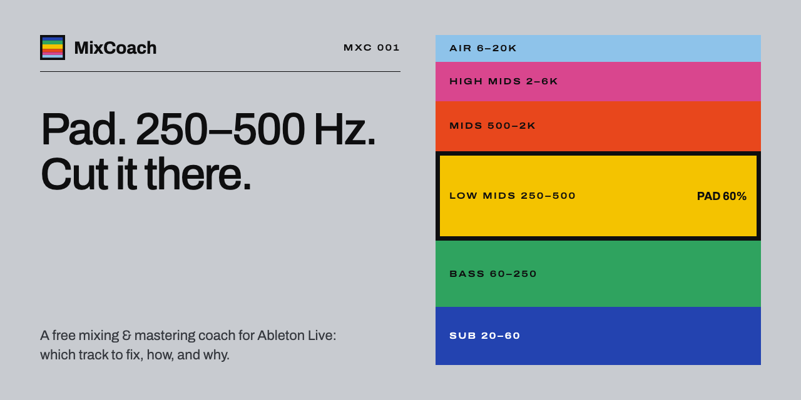
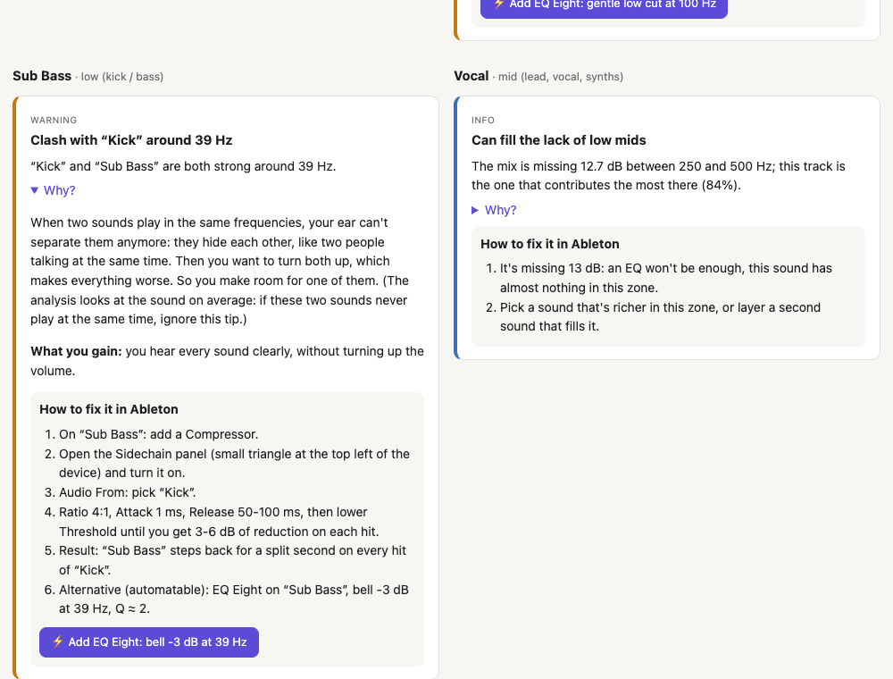
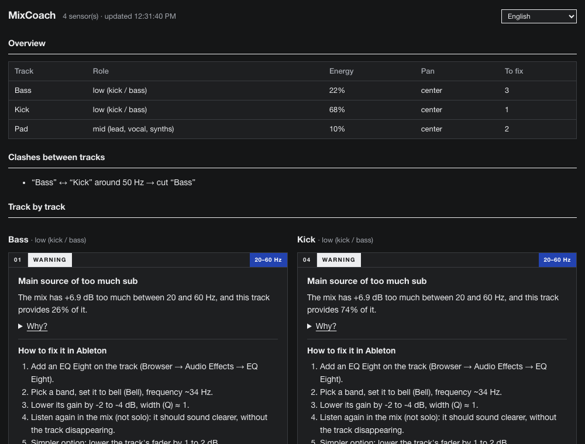
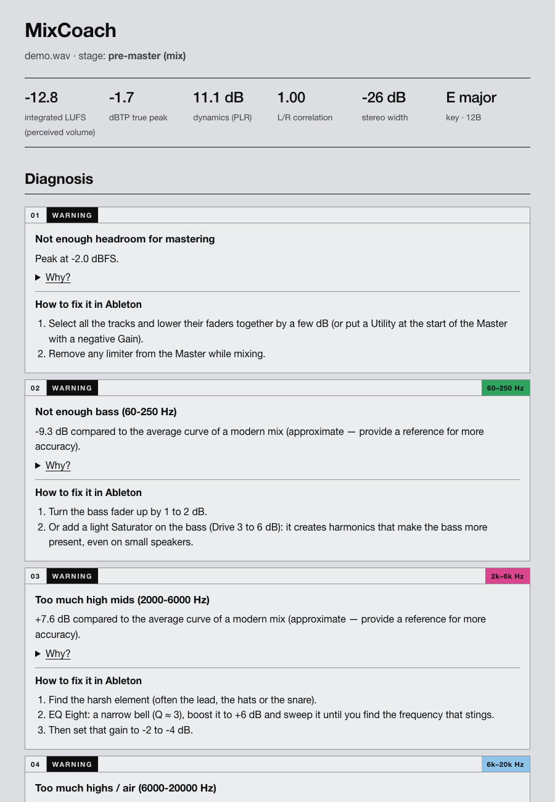
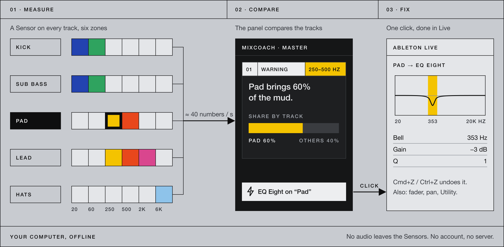

<p align="center">
  
</p>

<p align="center">
  <a href="https://github.com/xeewi/mixcoach/actions/workflows/tests.yml"></a>
  
  
  
  
  <a href="LICENSE"></a>
</p>

<p align="center">
  <b>English</b> · <a href="README.fr.md">Français</a> · <a href="https://xeewi.github.io/mixcoach/">Website</a>
</p>

<p align="center">
  <a href="https://github.com/xeewi/mixcoach/releases/latest/download/MixCoach.zip"></a>
  <br><sub>Free · macOS &amp; Windows · Ableton Live 12 + Max for Live · <a href="https://github.com/xeewi/mixcoach/releases">all versions</a></sub>
</p>

---

**MixCoach listens to every track of your Ableton Live project and tells you, in plain words, what to fix in your mix, how to do it in Ableton, and *why* it matters.**
It's made for producers who never learned mixing or music theory. You don't need to know what "masking" or "headroom" means: MixCoach explains it like a friend sitting next to you in the studio. When you're in a hurry, a ⚡ button applies the fix for you.

<p align="center">
  
</p>

## Why MixCoach?

Most beginner mixes have the same handful of problems: a muddy low end, a kick and a bass fighting each other, a harsh lead, a bass that falls apart on a club system. Spectrum analyzers *show* you these problems as curves, which only helps if you already know how to read them.

MixCoach goes one step further:

- 🎯 **It compares your tracks with each other**, not just the master. It doesn't stop at "too much 300 Hz": it tells you *"the Pad brings 60% of the mud between 250 and 500 Hz, cut it there"*.
- 🗣️ **It explains everything in everyday words**, with images ("like two people talking at the same time") and always says what you gain by fixing it.
- 🛠️ **It speaks Ableton**: every tip is a list of steps with real device and parameter names (EQ Eight → Bell → 120 Hz → −3 dB).
- ⚡ **It can fix things for you**: one click recenters a pan, raises a fader or adds an EQ Eight / Utility with the right settings. Cmd+Z / Ctrl+Z undoes it.
- 🌍 **It speaks 18 languages.**
- 🔓 **It's free, open source, and runs offline.** No account, no server, no AI service: just math on your audio.

## Features

| | |
|---|---|
| **Live analysis in Ableton** | A small *Sensor* device on each track measures the sound while you play. The *MixCoach* panel on the Master compares everything. |
| **Automatic setup** | The optional *MixCoach Auto* Remote Script adds the sensors to every track by itself, including new ones. |
| **Track-vs-track clashes** | Finds pairs of tracks fighting for the same frequencies and decides which one should make room (the kick always wins the low end). |
| **Culprit finder** | When the mix has too much (or too little) of a frequency zone, it names the tracks responsible. |
| **Low-end hygiene** | Useless rumble on pads and synths, stereo bass, off-center kick or bass. |
| **Master checks** | Headroom for mastering, clipping, phase problems, mono compatibility. |
| **Mastering report** | For an exported file: loudness (LUFS) for streaming or club, true peak, dynamics (PLR), tonal balance against a target curve or **your own reference track**. |
| **Music theory corner** | Detects the key of your song and shows its scale, its chords, its relative key, its Camelot code for DJs, and how to set Live 12's *Scale* mode. |

<p align="center">
  
</p>

## Quick start

### 1. In Ableton Live (recommended)

> Requires **Ableton Live 12 Suite** (or Standard + Max for Live), on **macOS** or **Windows**.

1. **[Download MixCoach.zip](https://github.com/xeewi/mixcoach/releases/latest/download/MixCoach.zip)** (always the latest version) and unzip it.
2. Copy the **`MixCoach`** folder (2 devices + `mixcoach.js`) to
   - macOS: `~/Music/Ableton/User Library/Presets/Audio Effects/Max Audio Effect/`
   - Windows: `Documents\Ableton\User Library\Presets\Audio Effects\Max Audio Effect\`
   - Not sure? In Live's browser, right-click **User Library** → *Show in Finder / Explorer*.
3. *(Optional, but magic)* copy the **`MixCoachAuto`** folder to
   `User Library/Remote Scripts/` (same User Library as above), restart Live, then pick **MixCoachAuto** as a Control Surface in
   *Settings → Link, Tempo & MIDI*. Sensors will now add themselves to every track.
4. Otherwise, drag **MixCoach Sensor** onto each track (at the end of the chain) and **MixCoach** onto the **Master**.
5. Press play. After a few seconds, the panel fills up. Click **⤢** to open it in a big window, and pick your language in the top-right menu.

### 2. Analyze an exported mix (mastering report)

```bash
git clone https://github.com/xeewi/mixcoach.git && cd mixcoach
python3 -m venv .venv && .venv/bin/pip install -r requirements.txt

.venv/bin/python mixcoach.py my_mix.wav                                  # mix before mastering
.venv/bin/python mixcoach.py my_master.wav --stage master                # master for streaming (−14 LUFS)
.venv/bin/python mixcoach.py my_master.wav --stage master --target club  # loud club master (~−8 LUFS)
.venv/bin/python mixcoach.py my_mix.wav --reference pro_track.mp3        # compare with a pro track you love
```

Export from Ableton with *File → Export Audio/Video*, **Normalize off**. An HTML report opens in your browser.

> 💡 **Use `--reference`** with a professional track in the style you're aiming for. The generic target curve is only a rough guide: even pro tracks deviate from it by ±5 dB.

### 3. Analyze every track of an export

In Ableton, export with *Rendered Track: **All Individual Tracks***, then:

```bash
.venv/bin/python tracks.py ~/Music/Exports/my_project/
```

The master file is recognized automatically. Group tracks (Drums, etc.) are detected and skipped, so their sound isn't counted twice.

<p align="center">
  
</p>

## How it works

<p align="center">
  
</p>

1. **Measure.** Each sensor runs a bank of 28 third-octave filters (31 Hz → 16 kHz), plus stereo and peak meters. It takes the track's fader, pan and mute into account. No audio leaves the device: it only shares about 40 averaged numbers, once per second.
2. **Compare.** The brain (`m4l/brain.js`) looks at who occupies which frequency, where the mix deviates from a target curve calibrated on professional electronic tracks, and which pairs of tracks mask each other.
3. **Explain.** Each finding comes with the facts, a plain-language "Why?", what you gain by fixing it, the steps in Ableton, and, when possible, a ⚡ automatic fix.

The Python tools (`mixcoach.py`, `tracks.py`) and the Max for Live brain share the same rules and the same sentences. A test checks that both give **exactly the same advice** on the same audio.

### What gets measured

| Measure | What it means for you |
|---|---|
| **LUFS** (integrated) | How loud your song *feels*, the number Spotify & co. use to turn songs up or down. |
| **True peak** (dBTP) | The real peak between samples. Above −1 dBTP, MP3/AAC conversion can distort. |
| **PLR** | Gap between peaks and average loudness = your dynamics. Too low = squashed, tiring sound. |
| **Tonal balance** | Energy in 6 zones (sub, bass, low mids, mids, high mids, air) vs. a target or your reference. |
| **Clashes** | Two tracks loud in the same third-octave band at the same place in the mix. |
| **Stereo** | L/R correlation (phase), width, and whether the low end below 120 Hz is mono. |
| **Key** | Krumhansl-Kessler key profiles → scale, chords, relative key, Camelot code. |

## Languages

English · Français · Español · Deutsch · Italiano · Português (Brasil) · Nederlands · Polski · Русский · Українська · Türkçe · العربية · हिन्दी · Bahasa Indonesia · 日本語 · 한국어 · 简体中文 · 繁體中文

- **In Live:** language menu in the top-right corner of the panel. The default is your system language, and the sensors follow your choice.
- **Reports:** `--lang ja` (default: system language, or the `MIXCOACH_LANG` environment variable).
- Ableton device and parameter names (EQ Eight, Low Cut, Threshold…) stay in English, exactly as they appear in Live.

Spotted a clumsy translation? Translations live in [`i18n/`](i18n/), one JSON file per language. See [Contributing](#contributing).

## Project layout

```
mixcoach.py           analysis of a whole mix / master  →  HTML report
tracks.py             track-by-track analysis of an export  →  HTML report
i18n.py, i18n/        translation system + 17 translation files (French is the source language)
m4l/
  brain.js            the advice engine used inside Ableton (same rules as tracks.py)
  mixcoach.js         Max script: measurements, Live API, ⚡ fixes
  ui.html             the panel page (rendered by Max's jweb)
  build.py            builds the .amxd devices  (--install copies them to your User Library)
  MixCoachAuto/       Remote Script that adds the sensors automatically
run_tests.py          runs every test
```

## Development

```bash
.venv/bin/python run_tests.py            # all tests, with a summary
.venv/bin/python m4l/build.py --install  # rebuild + install the devices (refuses if a test fails)
.venv/bin/python i18n.py                 # list translatable sentences, check every language
```

On Windows, use `.venv\Scripts\python` instead of `.venv/bin/python`.

**Publishing a new version:** `git tag v0.3.0 && git push --tags`. GitHub Actions runs the tests, builds the devices and publishes `MixCoach.zip` on the Releases page. The download links always point to the latest version.

Tests are plain Python scripts built on synthetic audio with known defects ("a stereo bass at 55 Hz must be flagged"). They also check that the JavaScript brain matches the Python one, that the Max script answers ⚡ clicks, and that all 18 languages are complete. They run on every push via GitHub Actions.

## Contributing

Contributions are very welcome, especially:

- 🌍 **Translations.** Native speakers: please review your language! Each file maps the French sentence to its translation. Keep the `{placeholders}` and the Ableton names, then run `python i18n.py` to check.
- 🪟 **Windows testing.** Windows support is brand new: if you use Live on Windows, tell us how it goes!
- 🎚️ **Mixing knowledge.** Better thresholds, better explanations, genre-specific target curves.

Please run `python run_tests.py` before opening a pull request.

## Known limitations

- **Live 12.3+** is needed for ⚡ fixes that *add* a device (EQ Eight, Utility). Fader and pan fixes work on any Live 12.
- Clashes are judged on the average spectrum: two sounds that never play at the same time may still be flagged.
- The generic target curve is tuned for modern electronic music. For other genres, use `--reference`.
- **Windows:** supported, and the analysis is tested on Windows by CI, but the devices haven't yet been tried inside Live on a Windows PC. Feedback welcome.

## License

[MIT](LICENSE). Free to use, modify and share.

Built on [NumPy](https://numpy.org), [SciPy](https://scipy.org), [soundfile](https://github.com/bastibe/python-soundfile) and [pyloudnorm](https://github.com/csteinmetz1/pyloudnorm) (ITU-R BS.1770 loudness). Key detection uses the Krumhansl-Kessler profiles.
